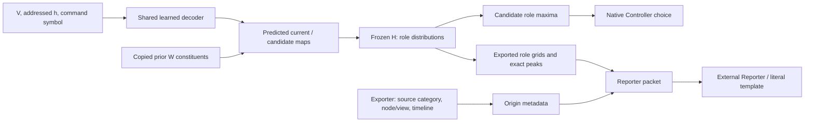

# Native model readouts and supplied provenance

2026-10-19. Static inspection separates the learned content being described from
the machinery that supplies report metadata. The [bound audit](../audits/attention_relational_report_v1/template_attribution_v1/semantic_review/root_adjudications/first_native_readout_provenance_audit.json)
retains exact committed source, hashes and function excerpts. No fitted model or
tensor archive was loaded and no new report was generated. Root is an exposed project author;
this is not an independent semantic review.

The learned source has addressed recurrent `h` plus history bookkeeping. Its
shared decoder takes sensory V, the addressed hidden vector and a command symbol
to estimate maps. Current assembly copies the previous W and replaces the last
commanded address with a learned estimate. Candidate assembly replaces the queried
address with each conditional estimate. The native Controller reads candidate
maps through frozen H, compares queried-role maxima and chooses an operation.
The external Reporter receives exported current/candidate role fields and metadata.

The diagram shows computational dependencies; it identifies no experiencing
subsystem. The export reuses retained fields rather than executing H again.

| Report datum | Computational producer | What its accuracy establishes |
| --- | --- | --- |
| Learned map estimate | Native shared decoder from V, h and symbol | A bounded prediction of map contents |
| Red/blue role distribution | Frozen H applied to maps, retained in the archive | A derived content readout; candidate fields also feed native choice |
| Complete peak set | Exporter's exact-maxima calculation | A checkable property of the supplied role distribution |
| `history_estimate`, `copied_prior_record`, origin times | Exporter's `_origin`, using source category, address/view roles and the fixed timeline | Provenance of the described estimate |

The [native decoder and assembly](https://github.com/macterra/attcon/blob/657a1b74af388a231652e471d7f0d36c70a8e24a/scripts/attention_content_model_v1.py#L205)
share the learned prediction path. The [choice function](https://github.com/macterra/attcon/blob/657a1b74af388a231652e471d7f0d36c70a8e24a/scripts/attention_content_model_v1.py#L489)
uses candidate fields. In contrast, [_origin](https://github.com/macterra/attcon/blob/657a1b74af388a231652e471d7f0d36c70a8e24a/scripts/attention_relational_report_v1.py#L206)
receives no numerical field, hidden state or model weight. It constructs labels
and time fields from the source/view/address arrangement. The literal template
then prints this metadata beside the content peaks.

The [verified A-content case](../audits/attention_relational_report_v1/template_attribution_v1/semantic_review/root_adjudications/first_actual_A_binding_case_05.md)
still reports a genuine learned A peak at `(1,2)`, different from the comparison W
estimate. Its accompanying history-estimate status accurately describes the
estimate's provenance. This accuracy does not demonstrate a learned representation
of access or appearance status inside h. The metadata's source attribution
identifies which estimate it describes; its labels are supplied by the exporter.
This distinction matters when interpreting a content/status conjunction as
evidence about the proposed quale-generating model.

Derived readouts and provenance can legitimately describe an internal model.
There is no requirement that the model contain native words such as “estimated”
or “conscious,” and this static audit does not exclude implicit representations
inside h. It also changes no frozen reference criterion, first judgment, original
scope or binding. The existing organization/status disputes remain unresolved.
Accurate report content, report meaning and the source-of-qualia inference remain
separate questions for the complete fixed analysis.
