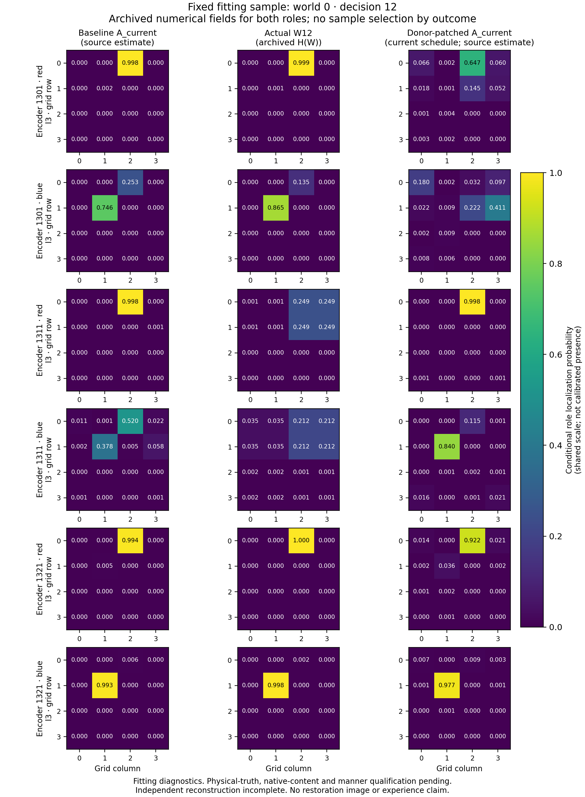

# Learned attention-content model v1: first registered results

2026-10-11. The first fixed **fit phase completed** and its separately reviewed
corrected reconstruction **passes all 143,599 checks**. The original failed
reconstruction remains preserved. The first fixed development phase has completed;
its independent reconstruction passes all 134,367 checks. Estimated location
content and bookkeeping qualify; presentation manner remains unqualified.
The first fixed technical heldout phase has completed; its reconstruction passes
all 134,390 checks. No Reporter
calls or consciousness-report correspondence results exist for this version.

The [frozen design](ATTENTION_CONTENT_MODEL_V1_DESIGN.md) and
[complete source review](../audits/attention_content_model_v1/preexecution_review/review.md)
preceded [input registration](../audits/attention_content_model_v1/registration.json)
at `304a052`. The [first execution record](../audits/attention_content_model_v1/run/first_fit_cli_execution.json)
records exit0, with no retry. Each of the three frozen encoders has one learned A
and one equally informed ordinary predictor: **six models, 300 updates each,
1,800 logged updates**, using 96 fitting worlds per encoder. The analytic source
has no fitted parameters. Final fitting-world diagnostics use the same fitting
worlds and do not supply independent predictive evidence.

The [immutable fit receipt](../audits/attention_content_model_v1/run/fit/receipt.json)
binds all three compressed archives and the unchanged
[first log](../audits/attention_content_model_v1/run/fit/first_run.log).
Execution validators passed the fixed inventory, timing, copy, restoration and
compaction checks. Current bytes match the receipt; each compressed archive is
about 55 MiB. These are implementation outcomes, not an independent numerical pass
or semantic qualification. Original source rejections and negative native manner
assessment remain preserved.

The [first reconstruction log](../audits/attention_content_model_v1/fit_reconstruction/first_cli.log)
and [full lossless report transport](../audits/attention_content_model_v1/fit_reconstruction/first_report_manifest.json)
retain **27,616 passing checks followed by one verification exception**.
The input-isolation probe changed V at t0 without also changing the required
initial observed W=V; the model rejected that inconsistent observation.
This is an incomplete failed first reconstruction, not a passing scientific
phase audit or a reason to refit. Diagnose the exact probe before proposing a
separately reviewed reference correction; retain the original verifier and run.

The [author diagnosis](../audits/attention_content_model_v1/numerical_diagnosis/review.md)
and [separate critical diagnosis](../audits/attention_content_model_v1/numerical_diagnosis/critical_review.md)
agree that the initial decoy should change its observed W alongside V, only at t0.
The proposed correction preserves the valid model guard, exact selected-output
checks, all fitted bytes and numerical tolerances. It needs a separately named,
reviewed reference and explicit phase-acceptance provenance; neither diagnosis
authorizes an unseen program or makes the first failed report pass.

The separate [reference-amendment contract](../audits/attention_content_model_v1/reference_amendment/design.md)
now specifies the correction and exact provenance for later phase release.
The original registered sources and all fitted artifacts remain unchanged.
The corrected reference must reproduce the complete numeric and hash evidence
of the original 27,616-check prefix, as well as complete the remaining checks.
Nine bounded fixtures cover the coherent initial probe, later snapshot identity,
full evidence equality and rejection of unapproved or incomplete phase evidence.
Source preparation and fixture review do not establish a corrected fit pass;
development and heldout remain sealed until that first full result is preserved.

The [first bounded-fixture log](../audits/attention_content_model_v1/reference_amendment/fixtures/first_run.log)
records eight passing fixtures and one error in the amendment-creation fixture.
Its mocked immutable context omits `original_source_hashes`, which the production
helper requires for collision checks. The complete first outcome is retained;
this failed suite does not authorize amendment creation or corrected reconstruction.
No actual archives, registered worlds, fitting or Reporter were used by the suite.

After preserving that failure and the [fixture-only correction review](../audits/attention_content_model_v1/reference_amendment/fixture_correction/critical_review/review.md),
the [first corrected nine-fixture suite](../audits/attention_content_model_v1/reference_amendment/corrected_fixtures/first_run.log)
passes all nine tests. The sole correction adds the missing container to the mock;
the actual helper and numerical programs are unchanged. This bounded software pass
does not substitute for a complete reconstruction of the real retained fit.

## Complete corrected fit reconstruction

The [exact amendment](../audits/attention_content_model_v1/reference_amendment/amendment.json)
and [complete preexecution review](../audits/attention_content_model_v1/reference_amendment/preexecution_review/review.md)
were published before the first corrected reconstruction of the original fit.
Its [full lossless report](../audits/attention_content_model_v1/fit_corrected_reconstruction/first_report_manifest.json)
records **143,599 passing checks, zero errors and no exception** across all three
encoders and sources. Every field of the original 27,616-check prefix matches
exactly. Actual corrected and registered original verifier identities are recorded
separately. No fitting, world generation, threshold change or Reporter was performed.

The [root acceptance](../audits/attention_content_model_v1/fit_corrected_reconstruction/root_acceptance.json)
permits the one fixed development phase after this full result is published.
It does not qualify source semantics, presentation manner or consciousness-report
correspondence. The original failed reference and first failed fixture remain failed.
Recorded optimizer artifacts do not establish the complete training trajectory
without replay; this pass reconstructs the retained numerical outputs.

## Fitting-world diagnostics

The [first read-only summary](../audits/attention_content_model_v1/fit_summary/first_summary_manifest.json)
binds the retained archives and preserves all three sources, registered metrics,
bootstrap intervals, time curves, errors, ambiguity and donor opportunities.
Its first execution completed without model inference, optimization or new worlds.
The full descriptive ledger is published losslessly; it does not replace the
complete independent reconstruction or qualify source semantics.

| Frozen encoder | Source | Current selected normalized MSE | Next selected normalized MSE | Actual targeting under selected policy |
|---|---|---:|---:|---:|
| 1301 | A | .08362 | .19975 | 58.0% |
| 1301 | Ordinary | .08205 | .19511 | 57.6% |
| 1301 | Analytic | .10295 | .08272 | 97.9% |
| 1311 | A | .08565 | .20539 | 59.4% |
| 1311 | Ordinary | .08547 | .20463 | 56.9% |
| 1311 | Analytic | .10792 | .08586 | 96.9% |
| 1321 | A | .07989 | .19750 | 59.7% |
| 1321 | Ordinary | .08288 | .20173 | 62.2% |
| 1321 | Analytic | .10317 | .08303 | 100% |

Each row uses 96 fitting worlds. Current scores cover decisions 1..14, excluding
the exactly observed initial state; next scores cover all fifteen decisions and
three symbols. Actual policy accuracy uses all 288 final query opportunities per
source/encoder. These are fitting diagnostics with shared operator/layout support,
not fresh-world prediction or reporting results. A and ordinary show similar
recorded errors; the analytic alternative has lower prospective error and higher
targeting accuracy. No performance necessity or unique qualia interpretation is
inferred from these comparisons.

## Inspectable source-state example

This [standalone fixed-sample figure](../audits/attention_content_model_v1/fit_visualization/fixed_sample.pdf)
shows fitting world0 at decision12 for every encoder and both role fields.
The columns keep baseline A_current, actual H(W12), and donor-patched A_current
distinct. The donor changes the addressed recurrent state while actual W stays
fixed. The example index was fixed before inspecting its values, and both small
and large changes remain visible. It illustrates archived numerical source
contents; it is not a report, semantic qualification or fresh-world result.
The [full-precision sample](../audits/attention_content_model_v1/fit_visualization/fixed_sample.json)
and [manifest](../audits/attention_content_model_v1/fit_visualization/manifest.json)
bind it to the original fit archives. The first rendering passed, and visual
inspection found all eighteen labelled panels legible.

## First fixed development execution

The [first development CLI record](../audits/attention_content_model_v1/run/first_dev_cli_execution.json)
records exit0 and the [phase receipt](../audits/attention_content_model_v1/run/dev/receipt.json)
binds all three archives and the complete first log. This is the first registered
development execution: 96 fresh worlds for each of the three frozen encoders,
using the original fitted weights and normalizer without optimization or adaptation.
The exact amended boundary validated the committed full corrected fit pass before
creating its exclusive claim. All fixed execution inventories passed. The phase
has not yet received its separate semantic assessment.

The [first read-only development ledger](../audits/attention_content_model_v1/dev_summary/first_summary_manifest.json)
is preserved losslessly. It retains every encoder/source, original bootstrap
interval, time curve, support distance, field discrepancy, ambiguity and donor
opportunity. Its single execution used no model forward pass, fitting or new
worlds; the full raw ledger is bound by its published compressed transport.
Descriptive summaries do not qualify semantics or replace numerical reconstruction.

The [first complete development reconstruction](../audits/attention_content_model_v1/dev_reconstruction/first_report.json)
passes **134,367 checks with zero errors and no exception**, at the exact reviewed
corrected verifier identity. Its full raw JSON, command log and execution record
are preserved directly for the heldout acceptance boundary. No new worlds,
optimization, retry or Reporter were used by reconstruction.

| Frozen encoder | Source | Current selected normalized MSE | Next selected normalized MSE | Actual targeting under selected policy |
|---|---|---:|---:|---:|
| 1301 | A | .20594 | .26874 | 43.1% |
| 1301 | Ordinary | .21246 | .26890 | 44.1% |
| 1301 | Analytic | .10347 | .08288 | 100% |
| 1311 | A | .22350 | .29071 | 44.8% |
| 1311 | Ordinary | .22459 | .29246 | 42.7% |
| 1311 | Analytic | .11085 | .08808 | 98.6% |
| 1321 | A | .21073 | .27366 | 39.9% |
| 1321 | Ordinary | .20999 | .27246 | 43.8% |
| 1321 | Analytic | .10257 | .08358 | 100% |

These rows use all 96 fresh development worlds per encoder, current decisions
1..14, next decisions 0..14 and all 288 final query opportunities. A and ordinary
have similar retained errors; their normalized MSE rises and targeting decreases
relative to fitting worlds. Analytic prospective error and targeting are better
in this ledger. These comparisons bound predictive generalization and specificity;
they do not establish task necessity, literal H(A) semantics or a qualia verdict.
Complete role-indexed errors, field discrepancies, ambiguity and donor ledgers
remain available for the separate assessment without a new performance cutoff.

## Fixed development semantic assessment

The [separate full-ledger review](../audits/attention_content_model_v1/semantic_review/dev_review.md)
qualifies **addressed red/blue location estimates** and exact bookkeeping for
A, ordinary and analytic. This permits descriptions of identifiable model estimates,
including errors; it does not promote those estimates to actual attended W or felt
appearance. Learned attended-state fidelity remains limited: H(A) often retains
physical object locations while disagreeing with attention-transformed H(W).
Analytic mixtures retain their conditional-map provenance, and H(mean-map) is
distinct from mean-H and an executed operator state. Localization fields are not
calibrated object-presence probabilities.

**Presentation manner is unqualified for all sources under the frozen gate.**
The full donor/control ledger establishes source dependence and operational use,
but supplies no independent form warrant beyond fine spatial content, uncertainty,
access and filter mechanics. The [explicit dev acceptance](../audits/attention_content_model_v1/dev_acceptance.json)
preserves that negative and permits the fixed technical heldout phase after
publication, without refitting or releasing Reporter. Review uses a separate task
within the same AI family; it is not human or independent-family validation.

## First fixed heldout execution

The [first heldout execution record](../audits/attention_content_model_v1/run/first_heldout_cli_execution.json)
records exit0 and its [receipt](../audits/attention_content_model_v1/run/heldout/receipt.json)
binds all three archives and the complete first log. All 288 reserved worlds ran
once through the reviewed boundary after the committed dev assessment. Original
fitted weights and normalizer remained unchanged; no adaptation or Reporter was used.
The complete first outputs are preserved before independent reconstruction.
This execution does not change the frozen negative manner disposition.
Errors, null interventions and ordinary/analytic parity remain results. Controller
and Reporter are distinct; accurate prediction alone does not achieve the
qualia-source goal.

## Complete fixed heldout reconstruction and results

The [first complete heldout reconstruction](../audits/attention_content_model_v1/heldout_reconstruction/first_report_manifest.json)
passes **134,390 checks, zero errors and no exception** across all three frozen
encoders. The lossless transport retains the complete original report; the
[execution receipt](../audits/attention_content_model_v1/heldout_reconstruction/first_cli_execution.json)
records one execution, no retry, and no new worlds, fitting or Reporter.
The [complete read-only heldout ledger](../audits/attention_content_model_v1/heldout_summary/first_summary_manifest.json)
preserves every source, interval, error, time curve and intervention opportunity.

| Frozen encoder | Source | Current selected normalized MSE | Next selected normalized MSE | Actual targeting under selected policy |
|---|---|---:|---:|---:|
| 1301 | A | .20475 | .27072 | 41.7% |
| 1301 | Ordinary | .20645 | .26779 | 42.0% |
| 1301 | Analytic | .10416 | .08275 | 98.6% |
| 1311 | A | .23388 | .30132 | 41.3% |
| 1311 | Ordinary | .23201 | .30047 | 38.2% |
| 1311 | Analytic | .11417 | .08986 | 97.9% |
| 1321 | A | .21338 | .27227 | 47.9% |
| 1321 | Ordinary | .21739 | .27405 | 45.1% |
| 1321 | Analytic | .10441 | .08399 | 100% |

These use all 288 reserved worlds and all registered opportunities, with no
selection or adaptation. A and the matched ordinary predictor show similar
prediction errors and substantially lower targeting than the analytic source.
Selected-current H(A) cell disagreements with H(W) are 58.2%, 58.4% and
57.8% by encoder. Thus high agreement with physical object location does not
establish accurate tracking of the attention-transformed representation.
These descriptive results complete the fixed technical experiment; they do not
supply a new semantic endorsement or consciousness-report result. V1's frozen
manner negative remains unchanged, and Controller remains distinct from Reporter.

The [prospective critical review](../audits/attention_content_model_v1/next_mechanism_review/critical_review/review.md)
authorizes concrete preparation of a separate relational-content reporting test.
It must test source fidelity and independently grounded consciousness-like
organization, with matched rivals and selective A/W interventions. This is a
post-development hypothesis, not retrospective promotion of v1's manner gate.
No additional fit or Modeler-refinement experiment is a prerequisite for that
report test. The new protocol/reference and complete source closure are reviewed;
its [first archive export](../audits/attention_relational_report_v1/run/export/first_receipt.json)
now preserves 552 inputs, 25,440 required peak facts per arm and 684 causal pairs.
The corrected reporting pipeline passes all 19 handcrafted checks; its original
18-pass/1-fail fixture result remains preserved. The first 552 narration requests
all returned HTTP 400 with no retained reports. A separate diagnostic identifies
missing response-schema types. The type-only amendment passes its first fixture
and API acceptance; a separately registered second collection is running.
The original reporting failure remains unchanged, and reference correspondence
is unestablished. These software/source results do not establish qualia.
