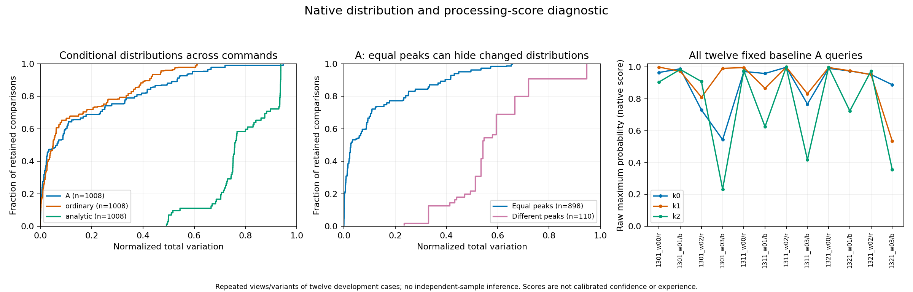

# Distribution changes and processing-command preferences

2026-10-20. **A literal report can stay identical while the attention model's
reconstructed processing-command preference changes.** The first complete
[diagnostic](ATTENTION_MODEL_DISTRIBUTION_GEOMETRY_V1.md) also establishes that
many equal-peak distributions differ substantially, rather than only by roundoff.
These are functional/source measurements, not consciousness-report correspondence
or evidence that the system experiences.

The complete [first result](../audits/attention_relational_report_v1/distribution_geometry_v1/first_result.json.archive.json)
retains all 552 positions, 804 panels, 6,336 command triples, 19,008 command
comparisons and 684 original pairs. The twelve sensor panels without forecasts
remain unavailable. All 19,008 actual command comparisons and all 1,008 original
pair-panel opportunities are comparable in this run; unavailable/mismatched cases
are separately covered by synthetic checks. No model or Reporter was run.

## Size and spatial structure

Total variation measures the fraction of normalized probability mass redistributed
between the two fields. Normalization is explicit and used only for geometry;
the exact source grids and raw native scores stay unchanged. Maximum source-mass
error is `4.18e-8`.

| Actual conditional source | Comparisons | Median normalized TV | 25th–75th percentile | Maximum |
| --- | ---: | ---: | ---: | ---: |
| A | 1,008 | 0.0655 | 0.00774–0.2785 | 0.9466 |
| Ordinary | 1,008 | 0.0497 | 0.01315–0.2457 | 0.6115 |
| Analytic | 1,008 | 0.7580 | 0.72380–0.9335 | 0.9375 |

For A's 898 equal-peak comparisons, median TV is 0.0273, with range
`0.0000464–0.6580`. Their median centroid L1 displacement is 0.0606 cells,
maximum 2.1722 cells. Equal peaks therefore need not mean the same distribution
or spatial geometry. This does not calibrate a meaningful perceptual difference,
clarity, subjective experience or correctness about W. Tiny differences remain
in the complete inventory rather than being selected out.

The figure is also available as a [PDF](../audits/attention_relational_report_v1/distribution_geometry_v1/first_figure.pdf).
Counts include repeated views/variants of twelve existing cases. They do not
constitute independent-system samples or powered estimator comparisons. Ordinary
and analytic also estimate attention-command effects; their differences/parity
do not test attention-model absence. Scores are not calibrated confidence.

## A concrete information omission

The published `NativePredictionReadout.choose` rule compares each command's
maximum probability at the queried node/role, selecting the first exact maximum.
All 168 retained A candidate-query groups have a unique winner. In 156 groups
all three command peak sets are identical, while the scores differ. The same
occurs in 152/168 ordinary groups; analytic has no such groups. These are repeated
source/view/variant groups, not independent systems.

One underlying case, encoder1321/world2 at n2/red, has exactly the same entire
literal template before and after the prospective donor intervention:

| Model state | k0 score | k1 score | k2 score | Reconstructed preference |
| --- | ---: | ---: | ---: | --- |
| Baseline | 0.953129 | 0.952228 | 0.975069 | k2 |
| Donor | 0.995894 | 0.991271 | 0.995848 | k0 |

The result appears in both A-only and joined views, which are **two views of one
case**. The exact donor margin is only `0.0000463724`; no robustness beyond the
retained float32 scores is asserted. W and recipient sensory evidence remain
fixed in this intervention. The source changes are genuine, but the peak-only
template omits control-relevant score information.

Across A's 24 prospective-donor pair-panel opportunities, all score triples
change and six preferences change; two of those six have equal entire templates.
Current-donor opportunities change six score triples and no preference. The
baseline/restored A score comparisons are exact, and W-change comparisons leave
A scores unchanged. All original pairs and directions remain in the
[descriptive summary](../audits/attention_relational_report_v1/distribution_geometry_v1/first_summary.json).
An unchanged preference is a real rule-level null, not a missing measurement.

These preferences are reconstructions from source fields, not verification of
saved executed actions. The native Controller later targets using actual W;
the external Reporter describes state. Neither is the processing-score readout.
The twelve fixed query examples use each packet's actual red/blue queried role,
and must not be confused with the earlier twelve red-only traces.

## Verification and interpretation

The reviewed source and contract were published at
`d2b5113b567ab32a8828a60501644ee1c0b6787a` before the
[single execution](../audits/attention_relational_report_v1/distribution_geometry_v1/first_execution.json),
which exited zero. Eight bounded tests pass after preserving the original source
review and its pre-execution bookkeeping corrections. The
[independent numerical reconstruction](../audits/attention_relational_report_v1/distribution_geometry_v1/independent_numerical_review/first_review.md)
then matches every grid, source/time identity, geometry value, native score rule,
pair and summary quantile, with zero errors and no retry. Maximum float64
arithmetic discrepancy is `3.44e-15`. The reviewer had already seen the method:
this is independent computation, not blinded methodology or semantic validation.

The 98,143,229-byte exact result has SHA-256
`1186e955ca9fc2e5228381d3e4dbe0610cf9dc73cc987397f0ac1fda3eb7307c`.
Its verified lossless gzip is 4,913,072 bytes. Original inputs and first judgments
are unchanged.

The **original narrator already received full localization fields**. Only the
literal template discarded their magnitudes; the new result is not an explanation
that missing input caused prose-audit failure. These H fields also do not constitute
the entire recurrent model state. A claim that the system reports its attention
model must identify which actual estimates, same-content relationships and
control-relevant quantities the report describes, while preserving error and scope.
Distribution geometry and score changes alone do not establish COD/CA or appearance.

The fixed semantic review remains unresolved, and the ultimate source-of-qualia
goal remains unachieved. A next experiment needs a distinct source/report question,
not another copy of the existing full-distribution input or a more fluent template.
