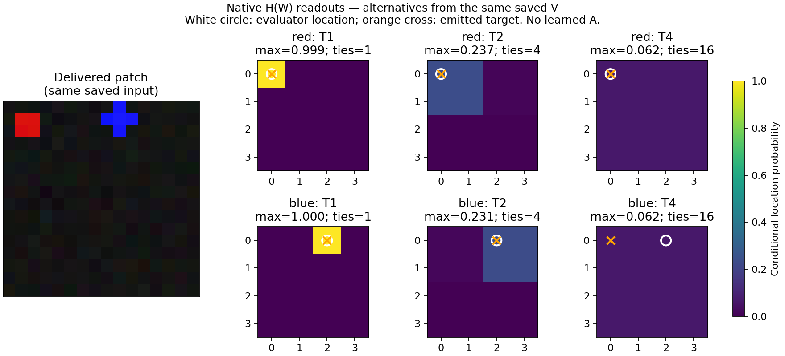

# Spatial native task v1: first development results

2026-10-11. The single registered development run completed. All three frozen
encoders support the declared native targeting task. The first independent
numerical verification failed and remains preserved; a separately reviewed
corrected reference now passes all 206,070 checks. No learned attention model
A or Reporter was run. Presentation manner and the source-of-qualia hypothesis
remain unqualified.

## Result and scope

The [protocol](SPATIAL_NATIVE_TASK_V1_PROTOCOL.md) fixed six head fits, three
encoder seeds, 128 fit and 64 diagnostic worlds per encoder, and 500 updates per
head before generation. The encoders and their original category/orientation
pathways stayed frozen. The new native consumer uses role-location fields from
actual completed W to select grid targets. It does not receive renderer truth,
pixels, retained identity or upstream V as a bypass.

The first run completed in approximately 108 seconds with all registered
engineering gates passing. Its 576 worlds include 768 diagnostic items and
4,608 primary role actions. All scheduled duplicate controls, errors, ties and
erased relations are retained. Fit and diagnostic position layouts overlap;
fresh nuisance realizations do not establish unseen-layout generalization.

| Encoder seed | T1 fine target | T1 coarse order | T2 fine target | T2 coarse order | Raw-grid fine target |
|---|---:|---:|---:|---:|---:|
| 1301 | 98.633% | 100% | 22.656% | 99.219% | 100% |
| 1311 | 96.875% | 100% | 22.852% | 100% | 100% |
| 1321 | 99.805% | 100% | 24.219% | 100% | 100% |

Each fine-target cell pools both roles over 512 queries per seed/operator;
coarse-order cells cover all 256 diagnostic items per seed/operator. The
[full results](../audits/spatial_native_task_v1/run/results.json) also expose
each role separately, all world means and conditional world-bootstrap intervals.
Those intervals do not describe uncertainty over people or model families.

T2 changes the role fields while retaining correctly represented coarse order
in 766/768 items (99.740%). This is the unconditional conjunction requiring both
T1 and T2 native orders to match truth, not a selected coarse-preserving subset.
T2's exact repeated blocks impose at least four tied maxima and a .25 balanced
fine-target ceiling. T4 yields sixteen ties, .0625 fine accuracy and unknown
coarse order in every item. These consequences of averaging do not establish
experienced blur or another phenomenal property.

This illustration uses encoder 1301, the first diagnostic world and address l0,
chosen by index rather than outcome. The fields are archived **H(actual W)**,
not learned attention-model contents. White circles show evaluator locations;
orange crosses show emitted actions. T2 repeats location evidence within blocks;
T4 makes every site equally probable. The [provenance record](assets/spatial_native_task_v1_fields.json)
binds the archive and figure bytes. Plotting generated no worlds, model inference
or fits.

## Independent first numerical verification

The [first review](../audits/spatial_native_task_v1/numerical_review/review.md)
reconstructs the archived equations and summaries without generating worlds or
refitting a head. It fails 106 of 206,070 checks, with no exception or retry:

- 35 discrete-policy comparisons against independently computed reference fields;
- 70 comparisons of original-path logits or control differences;
- one aggregate software-invariant verdict.

All 135 checks of policy against actual emitted fields, 34,560 Controller replay
checks and 1,599 summary comparisons pass. The engineering gates agree for every
model. Exact recorded T4 uniformity, T2 repeated ties and zero T2 margins pass.
Reference logits differ by small amounts that can change exact tie comparisons;
subtracted orientation controls can amplify arithmetic differences. The precise
cause is now accounted for by the [separately preserved arithmetic diagnosis](../audits/spatial_native_task_v1/numeric_diagnosis/review.md):
the reference used batched head arithmetic where the native consumer used an
individual item, and separate matrix multiplication/bias addition where the
control consumer used a linear operation. Matching those execution paths exactly
reproduces the archived values underlying all 106 failures. The [independent static adjudication](../audits/spatial_native_task_v1/numeric_diagnosis/independent_review.md)
supports a narrow reference correction. Diagnosis alone does not pass the original
audit. This is not permission to relax tolerances,
replace first results or call the failed full verification successful.

The [unchanged first log](../audits/spatial_native_task_v1/numerical_review/first_run.log),
[compressed complete audit](../audits/spatial_native_task_v1/numerical_review/metadata.json.gz)
and [byte-identity manifest](../audits/spatial_native_task_v1/numerical_review/metadata_manifest.json)
preserve every comparison. Decompression recovers the exact original 60.6 MiB
JSON bytes from a 1.1 MiB transport file. Review independence is separate task
allocation within the same AI model team, not an independent model family or
human endorsement.

## Separately labelled corrected revalidation

After exact source and design review and their publication at `ffcd400`, the
[corrected reference](../audits/spatial_native_task_v1/numerical_corrected_review/review.md)
ran once against the same archived experiment. **All 206,070 original checks
pass, with zero errors; their ordered names and count match the first audit
exactly.** The correction changes only reference execution shape/linear arithmetic
and preservation bindings. Fit and raw-head comparisons retain their actual
batched contexts; the native head retains itemwise computation. All numerical
tolerances, exact ties, task gates, data, weights and first results are unchanged.
No new worlds, fits, experiment retry or Reporter calls occurred.

The [complete compressed audit](../audits/spatial_native_task_v1/numerical_corrected_review/metadata.json.gz)
and [byte-identity manifest](../audits/spatial_native_task_v1/numerical_corrected_review/metadata_manifest.json)
preserve every comparison in 1.1 MiB instead of the 60.6 MiB raw JSON. Thirteen
additional preservation bindings are separate from the original check inventory.
This resolves numerical reconstruction on the retained data, not independent
replication or presentation qualification. The first failed audit is unchanged.

## What this advances

The retained outputs support a useful constituent-location representation and
an actual native action consumer. Allocation transforms alter this spatial
evidence while often retaining coarse order. Fine location, access and prescribed
filter mechanics remain sufficient interpretations; native task utility alone
does not qualify presentation manner. The [separate semantic review](../audits/spatial_native_task_v1/semantic_review/review.md)
retains that negative qualification, even if the numerical discrepancies are later
resolved.

The [content-form plan](ATTENTION_CONTENT_FORM_DEVELOPMENT_V1_PLAN.md) still requires
a learned, control-relevant A with separately scored current and prospective
contents, equally informed ordinary/analytic alternatives, selective A/W controls
and independently assessed report correspondence. Controller targeting remains
distinct from the absent external Reporter. The present stage cannot establish
that A supplies consciousness-like reports or is the source of qualia.

First source approval was committed at `2cdaafb`, registration at `3e92bd1`,
actual results at `614e74a`, failed numerical review at `432146a`, arithmetic
diagnosis at `0f8cf09` and corrected revalidation at `c84d3da`; each was pushed
before the next stage. The reviewed learned-model design is now approved for
bounded implementation; its actual run remains separately gated and unexecuted.
